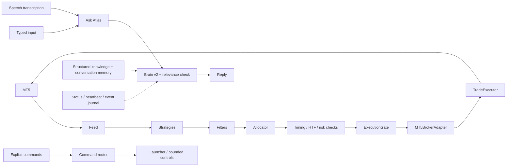

# Full Atlas system audit — 4 November 2026

## Scope and architecture

Reviewed the startup/runtime path, MT5 feed, signal generation and eligibility,
timing/HTF checks, risk manager, guarded execution, broker adapter, reconciliation,
learning boundaries, Brain v2 answering and memory, voice, command routing, UI and
observability. All application Python files received a syntax compilation check;
the current UI JavaScript received a Node syntax check. Dependency consistency
was checked with `pip check`. The isolated regression workspace contains the
application and tests at recorded SHA-256 hashes, without live credentials.

This is an architectural overview, not a claim that every source line was
individually reviewed or that finite testing proves the absence of all defects.

## Confirmed defects repaired in this audit

| Area | Defect | Resulting behavior |
| --- | --- | --- |
| Order dispatch | Partial fills and accepted-but-not-filled orders could fall through to another send attempt | Accepted full, partial and placed results return immediately with their actual status |
| Order dispatch | Missing responses, transport exceptions and uncertain server results could trigger another send | Stop after the uncertain dispatch; retain unknown status for reconciliation |
| Fill reporting | Production adapter reported every success as fully filled for the requested volume | Preserve submitted/partial/filled status, actual returned volume and price |
| Reconciliation | Native status query was a placeholder | Query open orders and historical orders by ticket, using documented MT5 states |
| Reconciliation | An `ok=True, status=unknown` query could clear the review requirement | Unknown/unrecognized outcomes keep reconciliation required |
| Reconciliation | Only positions were listed, omitting pending orders | Include pending orders in the broker inventory used for orphan detection |
| Reconciliation | Missing average fill price could erase a previously known price | Retain the last known price when the query supplies none |
| Account boundary | Trade and housekeeping preflight did not verify that MT5 was still on the configured demo account | Reject missing configuration, changed account/server, and non-demo accounts before dispatch |
| Risk inputs | NaN/infinite values could pass ordinary comparisons | Invalid numeric snapshots and runtime values block; invalid sizing yields zero |
| Freshness | Negative runtime ages could pass the freshness comparison | Reject negative ages and invalid age limits |
| Startup readiness | A recent saved status could look healthy without a live worker | Require a fresh heartbeat from the matching live worker; preserve a PID-checked fallback for restricted Windows process visibility |
| Market data | Empty broker responses could reach DataFrame column access | Explicit feed failure with diagnostic metadata, before strategy evaluation |
| Voice | Word-confidence output was disabled while wake/sleep checks depended on it | Enable word confidence in both normal and microphone-fallback recognizers; keep existing command confidence thresholds |
| Voice | Non-finite recognition confidence could be clamped incorrectly | Invalid recognition confidence remains zero |
| Voice answers | Brief self-model answers lacked labels required by the shared relevance guard and were rejected | Grounded capabilities, limitations and self-knowledge summaries pass the same guard as typed answers |
| Desktop readiness | An old saved timestamp could make a live, responsive window look unavailable and provoke a duplicate launch | A read-only native check verifies the recorded wrapper's visible, responsive window; missing or hung windows remain unhealthy |
| Daily trade accounting | Trader checked order/deal IDs but gateway returned a broker order ID | Confirmed gateway results count toward the existing daily guard; failed and unidentified results do not |

The retry correction intentionally changes error handling: acceptance is not a
reason to resend, and uncertainty is not treated as rejection. Definitive broker
rejection handling remains compatible. This does not grant execution permission,
increase volume, remove approvals or enable real-money trading.

Strategy formulas, confidence thresholds, performance eligibility, pilot limits,
and configured risk amounts were not loosened. No training, strategy promotion,
conversation-memory control change or forced order was performed for the audit.

## Review of the remaining areas

| Area | Evidence / boundary |
| --- | --- |
| Portable startup | Current-user Python 3.12 virtual environment; no old `C:\Users\User` references found in active application/scripts/tools; launch configuration remains guarded demo |
| Signal and timing pipeline | Existing verified-retest adapter retained; before/after generation evidence available; no filter was disabled to produce a trade |
| Risk and approvals | Existing daily/weekly loss, open-position, session, pilot-family and approval checks retained; injected vetoes tested |
| Learning/adaptation | Slow/medium/fast reporting and bounded confidence metrics remain separate from command execution; evolution and live background historical training remain disabled in the running configuration |
| Brain v2 | Shared evidence/planning/relevance path retained, including validated specialist adapters and grounded blocker explanations |
| Conversation memory | Compact question/intent/domain/plan/conclusion context remains an answer-continuity mechanism, separate from the trader |
| Voice and typed questions | Both continue through Ask Atlas; command thresholds and explicit routing were not broadened; no separate voice brain added |
| UI and runtime | Desktop and API health checked after restart; API status/why/answer paths smoke-tested |
| Logs/history | New forward journal retained; earlier missing historical LFS object remains a recorded evidence gap |

## Clock findings and remaining limits

HFM documents winter server time as GMT+2 and summer as GMT+3. A raw broker clock
two hours ahead of UTC on 4 November is therefore consistent with its documented
server convention, rather than evidence that the Windows clock is wrong.
[HFM trading hours](https://www.hfm.com/sc/en/trading-instruments/trading-hours)

Some retained broker/bar timestamps are naive, and diagnostic fields named
`latest_tick_utc` / `latest_bar_utc` still reflect the raw API interpretation.
A complete broker-time migration must distinguish raw server wall time from
verified UTC, handle DST and historical query boundaries, and check session-label
compatibility. This audit does not silently shift those trading inputs. The
runtime cycle-age guard must not be described as a verified tick-age guard.

An earlier instrumented test run encountered a native Windows access violation.
Its cause was not established. This audit uses the complete test suite with the
pytest faulthandler instrumentation disabled; that disables instrumentation,
not test cases. No dependency upgrade or interpreter replacement is claimed as a
fix for that earlier crash.

Physical microphone capture and end-to-end live fills are distinct from mocked
recognition, simulated execution, historical-order reads and broker preflight.
No live order was forced to satisfy a test. Historical missing journal data was
not reconstructed. Actual cancellation remains explicitly unsupported by the
native adapter rather than being reported as successful.

## Primary API references

- [MT5 trade server return codes](https://www.mql5.com/en/docs/constants/errorswarnings/enum_trade_return_codes)
- [MT5 order submission](https://www.mql5.com/en/docs/python_metatrader5/mt5ordersend_py)
- [MT5 historical order lookup](https://www.mql5.com/en/docs/python_metatrader5/mt5historyordersget_py)
- [MT5 order states and properties](https://www.mql5.com/en/docs/constants/tradingconstants/orderproperties)

The latest validation results and runtime observations are recorded separately
in `docs/diagnostics/full_system_audit_verification_20261104.json`. Existing staged
user changes were preserved; audit repairs were not staged or committed.

## Validation results

- Full isolated snapshot: **1,504 passed, zero failures, errors or skips** in
  428.70 seconds. All 184 application Python files were included in the source
  inventory. The complete JUnit result and source hashes remain in the recorded
  audit workspace.
- After that full snapshot, live checks exposed the brief voice-answer rejection
  and desktop-liveness mismatch described above. Their bounded fixes received
  **23 passing voice/Brain tests** and **71 passing startup, routing, voice and
  relevance tests**, including five new regression cases in total. These groups
  overlap; their counts should not be added as if every test were distinct.
- The only application files changed after the full snapshot were the three
  brief self-model responses in `brain/synthesis.py` and read-only desktop
  liveness in `atlas_process_guard.py`. The trading-path source still matches
  the full-suite snapshot. This distinction is recorded in the verification JSON.
- The running API returned relevant capability, limitation, market self-knowledge,
  blocker, follow-up and learning-speed answers. The corrected three voice
  self-model answers also passed relevance through the actual HTTP endpoint.
- Actual read-only MT5 checks confirmed the matching configured demo account,
  Algo Trading enabled, Python API allowed, zero positions and zero pending
  orders. The implemented history query correctly identified the saved historical
  order as filled; that is **not a new fill** from this audit.
- Backend health passed with a matching worker heartbeat. Desktop health passed
  using current visible-window responsiveness despite its old saved timestamp.
- The bounded current journal scan found **96 HOLD decisions** from the requested
  demo launch through the scan time, with no malformed rows. It does not include
  old archives. Sixteen entries labelled `error` concerned desktop startup states,
  including normal intermediate stages and transient stability timeouts; they
  were not trader decision errors.
- `pip check`, Python syntax compilation, current UI JavaScript syntax and Git
  whitespace checks passed. No real diagnostic order was submitted.

Live and test evidence includes:

- `docs/diagnostics/full_system_audit_verification_20261104.json`
- `docs/diagnostics/full_system_current_journal_20261104.json`
- `storage/full_system_broker_observation_20261104.json`
- `storage/full_system_live_answer_checks_20261104.json` (includes the discovered pre-fix voice failure)
- `storage/full_system_live_voice_after_20261104.json`
- `storage/full_system_audit_final_launcher.err.log`
- `storage/full_system_audit_workspace_20261104.json`

Atlas was left running in guarded demo. Holding for missing qualifying evidence
or an existing strategy-performance restriction remains expected behavior, not
a reason to disable its filters.
